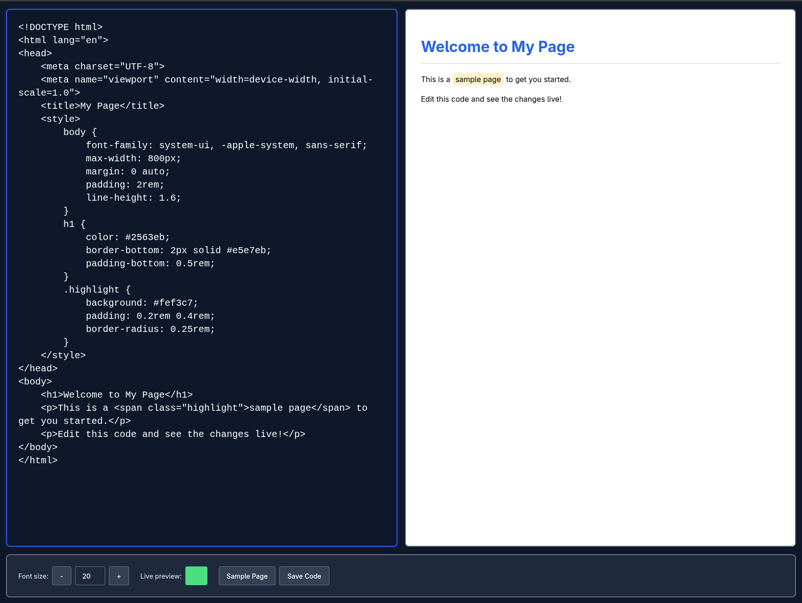

# Just Edit It

A simple HTML, CSS, and JavaScript editor with live preview. Perfect for rapid prototyping, learning web development, or testing code snippets without the need for complex development environments.




## Features

- **Live Preview**: See your HTML, CSS, and JavaScript changes in real-time
- **Simple Interface**: Clean, distraction-free editor with split-pane layout
- **No Setup Required**: Works immediately in any modern web browser
- **Offline Capable**: Continue coding even without an internet connection
- **Download Projects**: Save your work as HTML files with one click
- **Sample Templates**: Get started quickly with built-in examples
- **Responsive Design**: Works on desktop, tablet, and mobile devices
- **Keyboard Shortcuts**: Speed up your workflow with common shortcuts

## Getting Started

1. Open `index.html` in your web browser
2. Write your HTML, CSS, and JavaScript in the left editor panel
3. Toggle live preview to see your code rendered in real-time
4. Adjust font size using the controls or keyboard shortcuts
5. Save your work by clicking the "Save Code" button

## Keyboard Shortcuts

- `Ctrl/Cmd + S` - Save your code as an HTML file
- `Ctrl/Cmd + Enter` - Toggle live preview on/off
- `Ctrl/Cmd + +` - Increase editor font size
- `Ctrl/Cmd + -` - Decrease editor font size
- `Tab` - Insert tab character in the editor

## Use Cases

- **Learning Web Development**: Practice HTML, CSS, and JavaScript without setup
- **Rapid Prototyping**: Test ideas quickly before implementing in larger projects
- **Code Sharing**: Create small demos to share with others
- **Mobile Coding**: Code on tablets and phones with touch-optimized interface
- **Offline Development**: Work on projects without internet connectivity
- **Teaching**: Demonstrate web concepts in educational settings

## Technical Requirements

- Modern web browser (Chrome, Firefox, Safari, Edge)
- No server required - works as static files
- No installation needed
- Works offline after first load

## Project Structure

```
just-edit-it/
├── index.html      # Main application interface
├── main.js         # Application logic and event handling
├── default.css     # Styling and responsive layout
├── sw.js           # Service worker for offline functionality
└── manifest.json   # Progressive web app configuration
```
